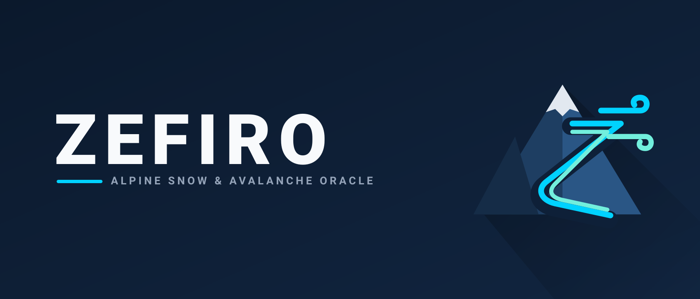

# Zefiro



> <em>Si chiama **Zefiro**, come il vento propizio che spazza via le nubi e indica la rotta giusta: è un motore che incrocia bollettini AINEVA, morfologia dei pendii, meteo e relazioni reali per suggerirci dove trovare la neve migliore in sicurezza.</em>

## Obiettivi

Creare uno strumento che aiuti a pianificare le uscite invernali in montagna in modo sicuro ed efficace, incrociando automaticamente rischio valanghe, meteo, morfologia del terreno e recensioni reali degli utenti.
L'app offrirà due modalità d'uso:
1. Scopri la gita migliore (Ricerca su Area): Seleziono una valle/zona, una data e il dislivello massimo; l'app filtra le gite pericolose e ordina le migliori per qualità della neve e meteo.
2. Radiografia Gita Singola (Verifica): Inserisco il nome di una gita (o carico una traccia .gpx) e ottengo un cruscotto diagnostico completo con meteo a diverse quote, pendenze critiche, storico valanghe e ultime segnalazioni.

## Fonti Dati e Link Utili

Il sistema aggregherà 5 fonti principali:
- Bollettini Valanghe (Pericolo del giorno):
    - AINEVA / Albina: Dati ufficiali su grado di pericolo (1-5), problemi valanghivi, fasce altimetriche ed esposizioni critiche in formato aperto (XML/JSON - standard CAAML).
    - Link: [AINEVA Open Data](https://www.google.com/url?sa=i&source=web&rct=j&url=https://bollettini.aineva.it/more/open-data&ved=2ahUKEwjTkcr2g42YAxVjTf4FHaN4KwcQy_kOegkIAggBCNECEAU&opi=89978449&cd&psig=AOvVaw0eR8Ap_Nax_0b9mg4MDK-Z&ust=1794937107114000) | Endpoint ultimo bollettino: 
- Storico Valanghe (Rischio strutturale):
    - Arpa Piemonte – Sistema Informativo Valanghe (SIV) / CLPV: Poligoni vettoriali (Shapefile/GeoJSON) delle valanghe storiche censite per verificare se una traccia attraversa canaloni noti.
    - Link: [Geoportale Arpa Piemonte](https://www.google.com/url?sa=i&source=web&rct=j&url=https://geoportale.arpa.piemonte.it/&ved=2ahUKEwjTkcr2g42YAxVjTf4FHaN4KwcQy_kOegkIAggBCNECEAw&opi=89978449&cd&psig=AOvVaw0eR8Ap_Nax_0b9mg4MDK-Z&ust=1794937107114000)
- Morfologia del Terreno (Pendenze reali):
    - Copernicus DEM (GLO-30): Modello digitale di elevazione (risoluzione 30m) per calcolare la pendenza reale metro per metro lungo la traccia GPX (individuando i pendii > 30°).
    - Link: [OpenTopography / Copernicus DEM](https://www.google.com/url?sa=i&source=web&rct=j&url=https://portal.opentopography.org/&ved=2ahUKEwjTkcr2g42YAxVjTf4FHaN4KwcQy_kOegkIAggBCNECEBM&opi=89978449&cd&psig=AOvVaw0eR8Ap_Nax_0b9mg4MDK-Z&ust=1794937107114000)
- Meteo e Nivometri (Previsioni e Storico recente):
    - Open-Meteo API: Gratuita senza API key; fornisce modelli ad alta risoluzione (ICON-D2, AROME) e dati storici per vento in quota, nevicate recenti e zero termico.
    - Link: [Open-Meteo Docs](https://www.google.com/url?sa=i&source=web&rct=j&url=https://open-meteo.com/en/docs&ved=2ahUKEwjTkcr2g42YAxVjTf4FHaN4KwcQy_kOegkIAggBCNECEBo&opi=89978449&cd&psig=AOvVaw0eR8Ap_Nax_0b9mg4MDK-Z&ust=1794937107114000) | [Archive API](https://www.google.com/url?sa=t&source=web&rct=j&url=https%3A%2F%2Fapp.archive.com%2Fapi%2Fv2%2Fdocs&ved=0CAAQ6vwSahgKEwjI9d-QhI2YAxUAAAAAHQAAAAAQ0w4&opi=89978449) (per test storici)
    - Windy Webcams API: Immagini reali dai rifugi/impianti vicini per verifica visiva.
    - Link: [Windy API](https://www.google.com/url?sa=i&source=web&rct=j&url=https://api.windy.com/&ved=2ahUKEwjTkcr2g42YAxVjTf4FHaN4KwcQy_kOegkIAggBCNECEB4&opi=89978449&cd&psig=AOvVaw0eR8Ap_Nax_0b9mg4MDK-Z&ust=1794937107114000)
- Itinerari e Condizioni sul Campo:
	- [Gulliver.it](https://www.gulliver.it/): Fonte primaria sul versante italiano per metadati gite e recensioni recentissime degli utenti (via scraping mirato).

## Prototipo

Primo prototipo della modalità **Scopri la gita migliore** con una **Radiografia** della gita.
Usa dati storici di una settimana: **10–16 febbraio 2026**, più i 5 giorni prima per vedere l'evoluzione.

- **Gite di esempio** (Gulliver): Monte Albergian da Soucheres Basses (Val Chisone, TO) e Monte Chersogno da Campiglione (Valle Maira, CN).
- **Bollettini**: AINEVA CAAML v6 (`albina_files/{data}/{data}_AINEVA_it_CAAMLv6.json`) e micro-regioni EAWS `IT-21-*`.
- **Meteo**: Open-Meteo Historical Forecast (neve, pioggia, vento, zero termico) alla partenza e in vetta.
- **Terreno**: Copernicus DEM GLO-30 (lettura COG parziale). Da qui vengono quota, pendenza ed esposizione per ogni punto della traccia.
- **Relazioni**: inserite a mano in `pipeline/config.yaml`, senza scraping automatico.

### Viste

- **Esplora** (`#/esplora/<data>`): lista e mappa interattiva delle gite del giorno, in stile mappa/lista.
  - Ogni gita ha un segnaposto con il punteggio e il giudizio (✓ consigliata, ! con cautela, ✕ sconsigliata). Le gite escluse dai filtri sono grigie.
  - Le micro-regioni sono colorate per grado di pericolo.
  - Il passaggio del mouse è sincronizzato tra card e segnaposto. Il popup apre la radiografia.
  - Quando sposti la mappa, la lista mostra solo le gite visibili (puoi disattivarlo).
  - Su mobile c'è un commutatore **Lista | Mappa**.
- **Radiografia** (`#/gita/<id>/<data>`): dettaglio della gita, con "← Torna alla mappa".

### Vista 3D

La sezione Mappa ha un commutatore **2D | 3D**. La vista 3D usa MapLibre GL JS, il terreno AWS Terrarium e una base topografica o satellitare. Contiene:
- la traccia colorata per rischio e sincronizzata col profilo;
- la sovrapposizione **Bollettino sul terreno**: celle DEM ≥ 30° con quota ed esposizione indicate nel bollettino del giorno, calcolate nel browser dalla griglia `data/grid_<gita>.json`;
- la sovrapposizione delle **classi di pendenza**;
- il **volo** lungo la traccia.

### Valanghe storiche (Arpa Piemonte – SIVA)

La pipeline scarica una volta il catasto valanghe SIVA (`valanghe.zip`, licenza CC BY 4.0) e legge i layer della provincia della gita:
valanghe documentate (`valterreno`, archivio storico `astv`), zone pericolose (`zoneper`), valanghe da fotointerpretazione (`valfoto`) ed eventi storici puntuali (`infostoriche`).
- `data/siva_<gita>.geojson` contiene gli oggetti nell'area della mappa, in WGS84.
- Ogni punto della traccia entro 30 m da un sito riceve gli id dei siti (`sv`).
- La radiografia mostra una striscia **Storico** sul profilo, i poligoni sulle mappe 2D e 3D (con scheda Arpa), una nota nel riepilogo e l'elenco dei siti.
- In Esplora la card mostra il numero di siti sulla traccia.

I dati sono **solo informativi**: non cambiano rischio, punteggio e giudizio.

### Avvio (Docker)

```bash
make data   # scarica i dati e genera web/public/data/*.json (con cache in pipeline/cache)
make up     # web app su http://localhost:8080
make down
```

### Struttura

```
pipeline/   Python (Docker): build.py + config.yaml → JSON statici
web/public/ app statica: index.html, js/engine.js (analisi), js/charts.js (SVG), js/app.js (UI + Leaflet)
```

### Logica di valutazione (semplificata)

- Ogni punto della traccia riceve il grado di pericolo per la sua quota e i problemi valanghivi validi per la sua quota ed esposizione.
- Il rischio puntuale usa il **metodo di riduzione di Munter** (semplificato): potenziale di pericolo / (fattore pendenza × fattore esposizione × fattore gruppo). Sopra 1 il tratto è "oltre soglia".
- I pendii sottovento al vento forte dei giorni prima sono segnati come possibili accumuli.
- La qualità della neve è una stima euristica su due fasce, in alto e in basso: neve fresca, vento, zero termico e pioggia.
- Punteggio = sicurezza 60 % + neve 25 % + meteo del giorno 15 %.

> Strumento di studio: non sostituisce il bollettino, la valutazione sul terreno e la formazione.
